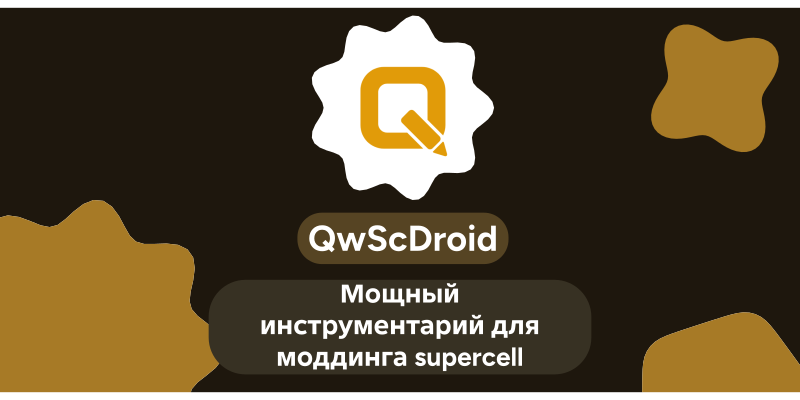
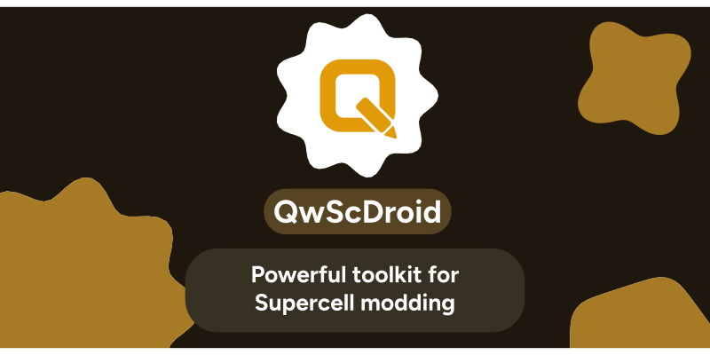

# Qw ScDroid

Инструменты для файлов Supercell на Android: SC, SCTX, KTX, GIF ↔ SC, редактор спрайтов и экспортнеймов.

Неофициальный проект, не связан с Supercell.

**Русский** · [English](#english)

---

## Возможности

- **PNG ↔ SC / SCTX / KTX** — замена и извлечение текстур, замена спрайта по ID Shape, замена атласа целиком (SC1).
- **GIF ↔ SC** — анимированный фон из GIF в SC и рендер MovieClip в GIF (слои, вложенные анимации, маски). Идея и формат — @Ghoul1337i.
- **Редактор SC** — атлас, спрайты, замена пачкой, экспорт ZIP, правка экспортнеймов, список MovieClip'ов.
- Material 3, динамические цвета, русский и английский (и любые другие — см. ниже).

## Сборка

- Kotlin + Jetpack Compose (Material 3) и нативная часть на C++ (`jni/`, `Android.mk`).
- В `jni/` нужны исходники сторонних библиотек: `astcenc/`, `zstd/`, `stb/` (см. `THIRD_PARTY_NOTICES.md`).
- Собирается Android Studio или на телефоне через CodeAssist.
- Файлы игры (SC, текстуры) в репозиторий не добавлять.

## Языки

Все тексты лежат в `app/src/main/assets/lang/*.json`. Новый язык — копия `en.json` с переводом значений.
Подробности — в `CONTRIBUTING.md`. Без пересборки можно положить файл в `Android/data/<пакет>/files/lang/`.

## Лицензия

[MPL-2.0](LICENSE): изменения в файлах проекта нужно публиковать под той же лицензией, но программу можно
использовать и объединять с кодом под другими лицензиями. Сторонние компоненты — в `THIRD_PARTY_NOTICES.md`.
Файл `MdLoadingIndicator.kt` — порт кода MargyT под GPL-3.0 (см. заголовок файла).

## Благодарности

- @Ghoul1337i — идея и формат GIF ↔ SC.
- Библиотека SC Downgrade.
- MargyT — индикатор загрузки (GPL-3.0).

---

## English

Android tools for Supercell files: SC, SCTX, KTX, GIF ↔ SC, sprite and export-name editor.
Unofficial project, not affiliated with Supercell.

**Features:** PNG ↔ SC/SCTX/KTX texture tools, GIF ↔ SC (idea and format by @Ghoul1337i), SC editor
(atlas, sprites, batch replace, ZIP export, export names, MovieClip list), Material 3 with dynamic colours.

**Build:** Kotlin + Jetpack Compose, native C++ in `jni/`. You need the sources of `astcenc`, `zstd` and `stb`
in `jni/` (see `THIRD_PARTY_NOTICES.md`). Do not commit game files.

**Languages:** texts live in `app/src/main/assets/lang/*.json`; copy `en.json`, translate the values, done.
See `CONTRIBUTING.md`.

**License:** [MPL-2.0](LICENSE). `MdLoadingIndicator.kt` is a port of GPL-3.0 code from MargyT (see its header).
